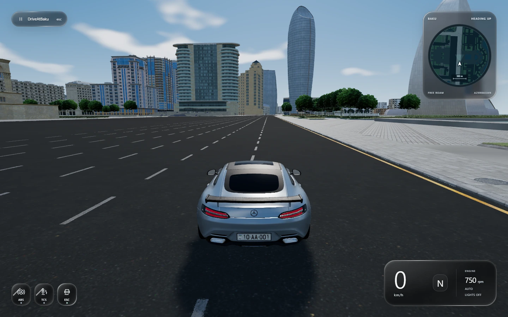

# DriveAtBaku

A fan-made browser driving game set on Baku's streets. Explore the city in four vehicles, change the weather and time of day, or drive alongside other players through a WebSocket relay.

**[Play DriveAtBaku](https://www.driveatbaku.games/)** · [Download Windows & Android](https://github.com/fuad-ismayil/DriveAtBaku/releases/latest) · [Vercel mirror](https://driveatbaku.vercel.app/) · [Documentation](docs/README.md)



*Current driving HUD, captured from the development build in Chrome.*

## Features

- Baku city geometry, surrounding streets and coastline, with audited race-event structures excluded from the playable scene.
- Ferrari 458 Italia, Elantra/Avante, Mercedes-AMG and Toyota Prado; saved vehicle selection, individual paint colors and configurable Azerbaijani license plates.
- Fixed-step vehicle dynamics, suspension, automatic/manual transmission, ABS, traction and stability aids, world collisions and follow/hood cameras.
- Day/night lighting, headlights, engine and tire audio, skid marks, and a heading-up minimap with a full-map view.
- A cohesive [Liquid Glass interface](docs/LOADING_EXPERIENCE.md) across loading, menus, garage and driving: clear neutral surfaces, capsule controls, consistent vector icons, readable backing and reduced-motion support. The assist display keeps only ABS, TCS and ESC indicators.
- Four native 4K loading scenes captured from the current game, with animated crossfades, selectable chapters, pause/resume, real download progress and retry handling.
- Independent nighttime room lights, [Government House](docs/GOVERNMENT_HOUSE.md) stone and window detail with a wind-driven Azerbaijani flag, and [rounded tree shading](docs/FOLIAGE_LIGHTING.md).
- Sunny, overcast, wet-road, rain and snow modes, adjustable precipitation and vehicle surface water. Weather affects appearance; it does not change driving grip.
- Performance, Balanced and Cinematic graphics presets, independent render/props distances, ambient occlusion and rendering-resolution controls. Balanced/Cinematic use HDR, SMAA and supported scene MSAA, cached shadows and local car reflections.
- Multiplayer with interpolated remote vehicles, player names and replicated vehicle appearance/effects. Remote cars are visual ghosts and do not collide with one another; a separate relay is required.
- An [ARM64 Android development preview](android/README.md) built with Godot, using the original driving equations, packaged assets, mobile Liquid Glass menus/loading, touch controls and compatible web/Android multiplayer.
- A [native Windows build](windows/README.md) using Godot Forward+, with four graphics presets, cascaded city shadows, ambient occlusion, screen-space reflections, keyboard/mouse controls and portable x64 packaging. Build it with `.\windows\build.ps1`.

## Getting started

Use **Node.js 22.12+ or 24+**, npm, and a modern desktop browser with hardware-accelerated WebGL 2. Desktop game checks use Google Chrome. The first desktop load downloads over 200 MiB of map and vehicle data; loading time depends on the connection and device.

Phones and tablets receive a lightweight download page and do **not** load the Web game or its assets. Detection includes Android desktop mode and iPadOS’s Mac-style identity, independently of screen size or orientation. iPhone/iPad visitors are told that the native packages support Windows and Android; there is no iOS app. See the [mobile download restriction](docs/MOBILE_DOWNLOAD_GATE.md).

```sh
git clone https://github.com/fuad-ismayil/DriveAtBaku.git
cd DriveAtBaku
npm ci
npm run dev
```

Open the local URL printed by Vite. Packed map assets and vehicle files are included; the original `levels/` directory and Python conversion tools are unnecessary for normal development. The relay has its own install and startup steps in [server/README.md](server/README.md).

## Build and deploy

```sh
npm run build
npm run preview
```

The production site is `dist/`. Netlify and Vercel configuration files already specify the build command and output directory. Keep `public/generated/asset-manifest.json`, its compressed asset parts, collision data and route data together. The build also includes the generated room-window mask under `public/assets/environment/`; its source metadata is `src/windowLightingAtlas.json`. Static hosting serves the game; it does not run the multiplayer relay.

See [map conversion](docs/MAP_CONVERSION.md) for optional asset regeneration and [verification](docs/VERIFICATION.md) for the checks to run before a release.

For the native Android client, follow the separate [Windows setup and build guide](android/README.md). Android assets, downloaded tools, native binaries and APKs are regenerated locally and excluded from Git; retain the source scripts, Godot resource UIDs and import/export settings. The [device results](docs/android/DEVICE_RESULTS.md) record the Galaxy S9 checks and limits. The [0.4 audio/plate report](docs/android/AUDIO_AND_PLATE_FIXES.md) explains the idle-loop correction, real registration lamps and measured bidirectional audio. Deploy the matching web client for public rooms; the latest recorded public relay probe already preserves the required audio state.

The **v1.0.0** release includes one portable Windows x64 ZIP and one Android ARM64 APK in the [same GitHub release](https://github.com/fuad-ismayil/DriveAtBaku/releases/tag/v1.0.0). Both share the displayed version. Windows uses the desktop interface, Forward+ graphics, display/aspect controls and a visible pause cursor; Android retains its mobile renderer and touch interface. Both native clients offer Quit game. See the [release guide](docs/RELEASE.md).

Web and Windows share a 176px camera-up minimap with independently oriented car markers, an interactive full map and a compact background-free readout at bottom center. Multiplayer names are white text with matching size, height and fading. The Web menu links to native downloads; native menus do not include Download. Version labels appear on loading/main-menu screens only.

Prepared models, immutable shader definitions, plate geometry and PCM loops are reused within bounded caches. Measured cached switching is much faster; cold loading, renderer stalls and sustained memory behavior remain separate concerns. The [mobile interface guide](docs/android/MOBILE_INTERFACE.md) records the original menu/loading architecture. [Multiplayer horn verification](docs/android/HORN_MULTIPLAYER.md) covers both sound directions, release, pause and stale peers. Pushing source alone does not install an Android build.

The [v1.0.0 review](docs/UNRELEASED_CHANGES.md) covers changes since `62f3a26`; the [0.7.2 review](docs/history/ANDROID_0_7_2_REVIEW.md) preserves earlier phone evidence. The approved [A1 branding](docs/branding/README.md) unifies the web favicon/menu, Android adaptive and themed icons, native boot screen and Windows executable. See [final validation](docs/branding/VERIFICATION.md) for export checks and current hashes.

## Controls

| Input | Action |
| --- | --- |
| W / S or ↑ / ↓ | Throttle / brake and reverse |
| A / D or ← / → | Steer |
| Space | Handbrake |
| T; Q / E; X | Toggle automatic/manual; shift down/up; clutch |
| 1 / 2 / 3 | Toggle ABS / traction / stability aids |
| C; mouse; middle mouse | Follow/hood camera; look around; hold to look behind |
| L; H | Cycle low beams / high beams / off; horn |
| Comma (,); Period (.); Slash (/) | Left turn signal; right turn signal; hazard lights |
| M | Full map |
| R; Shift+R | Recover in place; return to the start |
| Esc | Pause/resume |

Gamepad input supports steering, throttle, brake, handbrake, clutch and horn through the browser Gamepad API. The in-game **Controls** panel lists keyboard and mouse inputs. Graphics, atmosphere and audio settings are available in the pause menu and saved locally.

Desktop players use Esc to pause. Android retains its on-screen pause button. ABS, TCS and ESC appear as subtle text in the readout and can be changed with shortcuts or settings. Suspension graphs are no longer displayed; vehicle suspension behavior is unchanged.

Turn signals toggle off when pressed again. Selecting the other side or hazards replaces the current mode. All lamps on a car blink together (400 ms on / 400 ms off). Signals continue through pause, garage visits and recovery; changing cars clears them. Typing and held-key repeats do not toggle signals. Multiplayer needs the updated relay as well as the client; it shares the mode and blink reference with joining and existing players.

## Technology and structure

The client uses JavaScript modules, Three.js r180, `three-mesh-bvh`, WebGL and Web Audio, built with Vite. The multiplayer relay uses Node.js and `ws`. Python is used only for optional source-map/model conversion. Playwright and image-analysis packages support the browser checks.

| Path | Purpose |
| --- | --- |
| `src/main.js`, `src/startup.js` | Game loop, UI integration and startup |
| `src/glass.css`, `src/style.css`, `src/licensePlate.css` | Shared glass material, responsive interface and garage plate editor styling |
| `src/loadingScreen.js`, `src/loading.css` | Loading scenes, slideshow controls, progress and failure states |
| `src/deviceGate.js`, `shared/` | Device download policy, shared version metadata and UI dimensions |
| `windows/`, `android/` | Native Godot builds, platform interfaces and verification |
| `src/` | Vehicle dynamics, graphics, weather, cameras, audio, maps and collision modules |
| `src/net/` | Multiplayer transport, state replication and remote vehicles |
| `src/governmentHouse.js`, `src/flagCloth.js`, `src/roomLights.js`, `src/roomLightActivity.js`, `src/foliageLighting.js` | Landmark detail, flag simulation, independent rooms and canopy shading |
| `public/assets/`, `public/draco/` | Vehicle, environment, audio, font, loading and decoder assets |
| `public/generated/` | Packed map geometry, collision geometry, route and transfer manifest |
| `scripts/` | Asset tools, regression checks, profilers and plate-fit inspector |
| `server/` | Standalone WebSocket relay and load test |
| `docs/` | Maintained technical guides, asset credits and historical engineering reports |

`npm run capture-loading-art` regenerates the four loading images from a running development server. `npm run verify-interface-browser` checks the loading experience, responsive menus, icon alignment and driving UI in Chrome. See the [interface guide](docs/LOADING_EXPERIENCE.md) for server setup, preview captures and output locations.

## Contributing

Read [CONTRIBUTING.md](CONTRIBUTING.md) for the development workflow, verification commands and information to include when reporting a problem. Keep changes focused and provide reproducible evidence for changes to rendering, performance, handling or collisions.

## Credits and licensing

This repository currently has **no project-wide source-code license**. Public availability does not establish permission to reuse the source or all bundled assets. Third-party files retain their individual terms; see [asset credits](docs/ASSET_CREDITS.md), [audio sources](public/assets/audio/engines/SOURCES.md) and the [font license](public/assets/fonts/AZ-DIN-OFL.txt).

Redistribution terms for the Baku map and several supplied vehicle models remain unconfirmed. The Ferrari, audio and font attributions do not cover those assets. DriveAtBaku is not affiliated with the vehicle manufacturers, Formula 1 or the original track's rights holders.
