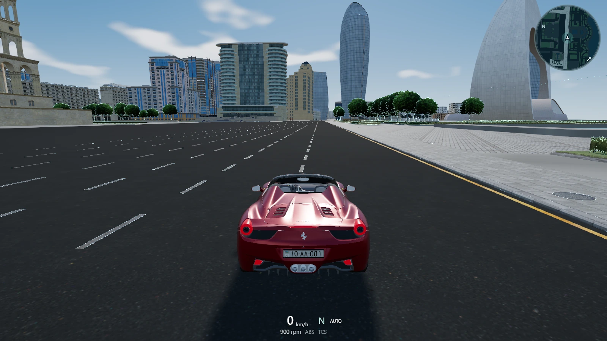
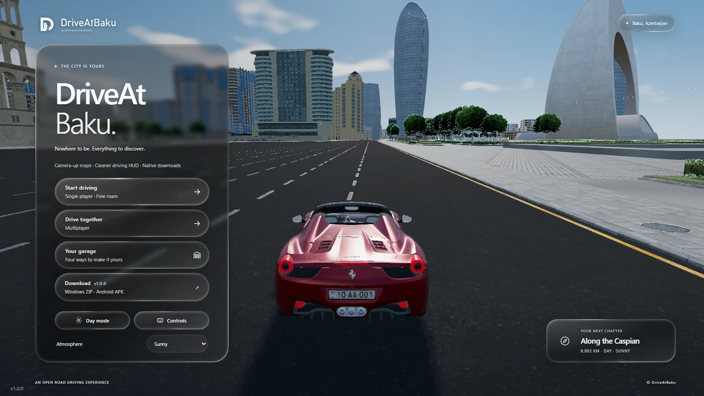
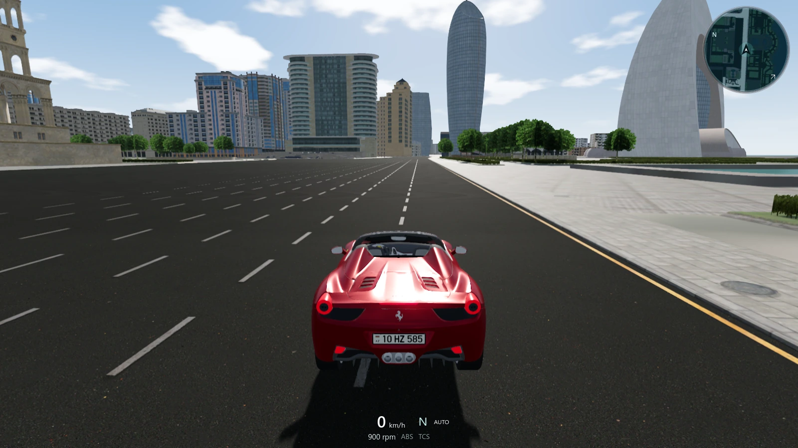
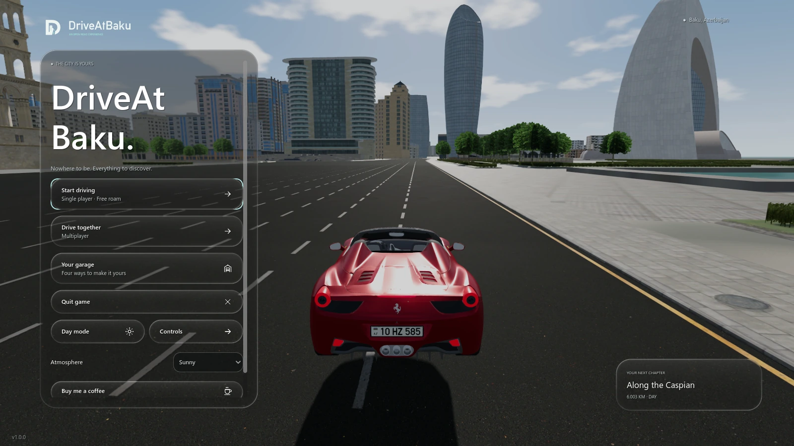
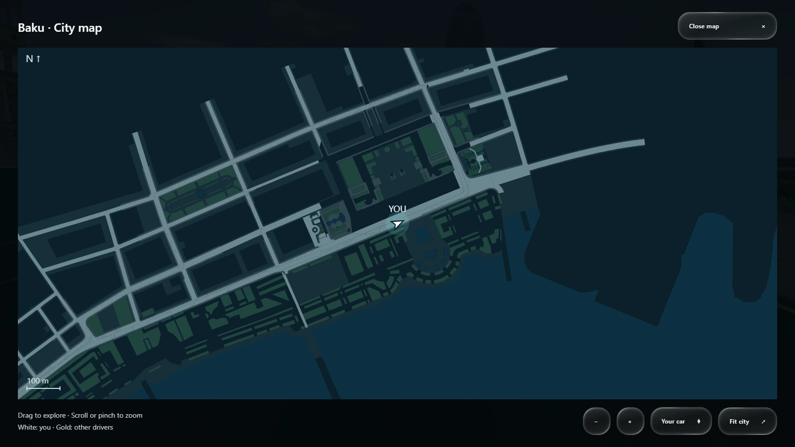
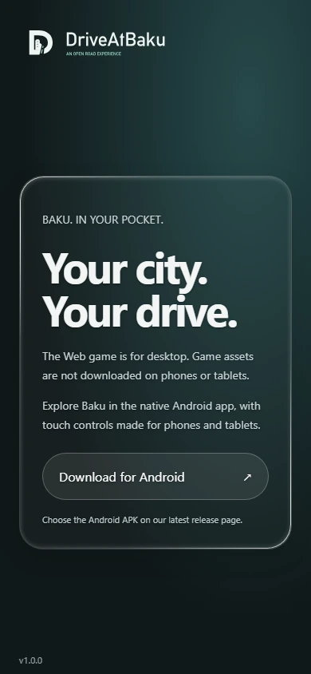
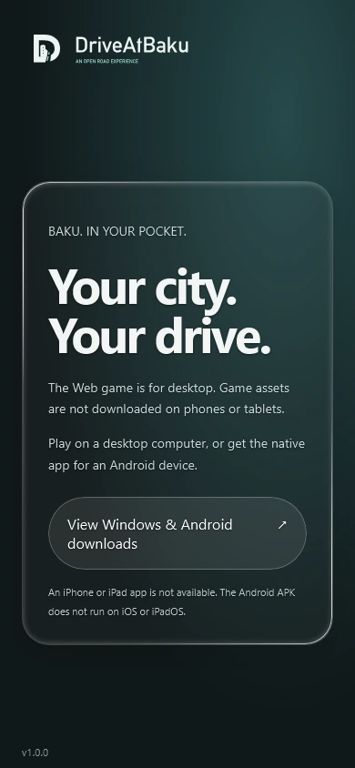

# v1.0.0 screenshots

Captured on 16 October 2026 from source `fe63770`. The Web menu, gameplay and
mobile download pages come from [the production website](https://www.driveatbaku.games/).
Windows and full-map captures come from the matching verification build.
Images preserve the original framing and dimensions and are encoded as WebP.
[Capture metadata](images/captures.json) records sources, sizes and checksums.

## Web gameplay

The larger circular minimap and compact transparent speed, gear, RPM and assist
readout are visible in the released desktop browser game.

## Web main menu

The menu shows current map/HUD highlights, v1.0.0 and the Windows ZIP/Android APK
download action.

## Windows gameplay

The native Godot build uses Forward+ graphics and the shared desktop map and
instrument layout.

## Windows main menu

The native menu includes Quit game. Downloads are available through the Web
menu and GitHub release.

## Full city map

The north-up map offers pan, zoom, Your car and Fit city controls.

## Mobile download pages

These production-page captures use simulated Android and iPadOS desktop
identities in real browser engines at 390 × 844. They show browser behavior
at a narrow viewport; they are not physical-device screenshots. Game assets
are blocked for both identities, including at larger viewport sizes.

| Android browser | iPadOS desktop identity, narrow viewport |
| --- | --- |
|  |  |

See the [mobile restriction and test coverage](MOBILE_DOWNLOAD_GATE.md) and
[release downloads](https://github.com/fuad-ismayil/DriveAtBaku/releases/tag/v1.0.0).
