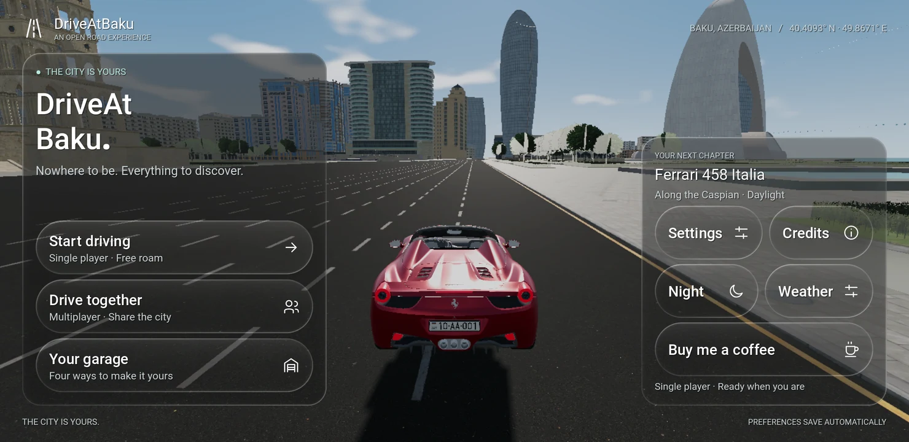
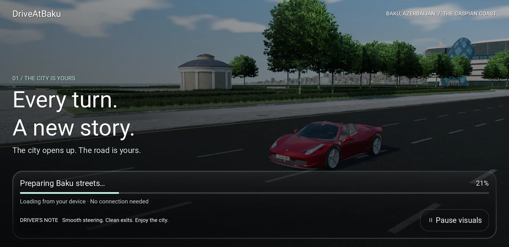
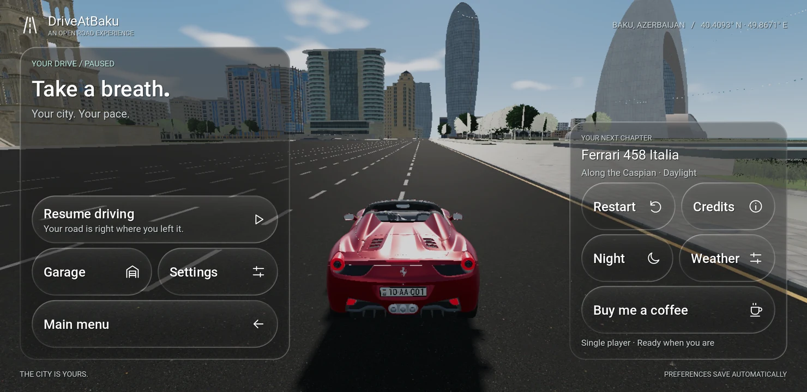

# Android mobile interface · 0.5

The Android client now shares the web's neutral Liquid Glass identity while
using native landscape navigation and controls. All runtime UI is GDScript
and canvas shaders; no WebView or web runtime is added.

## Screens and behavior

- **Main menu:** two-column composition with an editorial wordmark, free roam,
  multiplayer and garage actions; a smaller vehicle/atmosphere card contains
  settings, credits, day/night and developer support.
- **Loading:** original city/day and night captures from the web client,
  packaged locally at 1920 px wide. Animated crossfades, a visual pause control,
  eased progress and an exit transition accompany real preparation milestones.
  City and vehicle resource progress comes from Godot's threaded loader. Scene
  instantiation, collision loading and atmosphere setup report explicit stages;
  progress is not a timer or a download estimate. Failure shows a retry action.
- **Pause:** resume, garage/settings, return to main menu, restart at spawn,
  day/night, weather and support. Main menu departure closes the online room.
  Back returns from a supporting screen to pause, then resumes.
- **Supporting screens:** scrollable garage, paint and per-car registration;
  Driving, Graphics & audio, Atmosphere and Accessibility settings; multiplayer
  nickname/relay fields, connection feedback and Leave room; complete credits.
- **Support:** both main menu and pause open
  `https://kofe.al/@fuadismayil` through `OS.shell_open`, matching the web.
  If no browser can open, a dialog displays the address.

Every menu transition clears fingers, throttle, brake, steering target, camera
drag and queued shifts. Vehicle selection preserves the previous garage and
pause context. Focus loss pauses an active drive and suspends audio; returning
from a browser retains the menu the user left. Existing preferences retain
their original keys, including per-car plates.

## Glass, typography and touch

`glass_panel.gd` and `liquid_glass.gdshader` share a single scene copy beneath
the active interface. Rounded signed-distance lenses produce thin directional
rims, a restrained bevel, slight edge refraction and neutral transparency.
Bright scenery receives extra neutral backing to protect text contrast. The
Performance preset uses one texture sample per fragment; Balanced uses five
small, fixed samples. There is no blur pyramid or per-button viewport capture.
Startup disables the game copy and captures its artwork once per rendered frame.

The interface uses the device's system sans-serif font, a semibold hierarchy
and a consistent 24-unit vector icon grid rasterized to 96 px textures.
Primary controls have 88-unit minimum heights in the 1480 × 720 reference
canvas (44 dp at a 740 × 360 dp phone viewport). Menus respect Android safe
area insets; settings and long notices scroll. Buttons provide a small press
response, pages fade, and loading fades into the scene. Accessibility includes
reduced motion (`reduce_motion`) and deeper glass backing
(`reduce_transparency`), both off by default. Existing preference keys and
per-car registration settings are retained.

Brake and throttle use pedal pictograms inside their controls; slider mode
also shows their percentages. The circular handbrake defaults to the right
edge near vertical center, with a 24-unit inset, and moves upward when large
pedals would overlap. The horn sits between the steering arrows or centered
16 scaled units above the steering slider. Controls follow the existing size
and mirrored-layout settings. Hold the horn to sound it; release, touch
cancellation, opening a menu or focus loss clears it. See
[multiplayer horns](HORN_MULTIPLAYER.md) for audio and network behavior.
Safe-area handling applies to menus/loading; the driving HUD and touch layout
still use their own placement rules.

## Reproduce verification

`android/build.ps1` runs `prepare_interface.mjs` before importing/exporting.
Prepared images are generated from repository assets and stay out of Git.
On a fresh checkout, complete the [build prerequisites and Prepare step](../../android/README.md#build-on-windows)
first; the commands below assume native libraries and game assets are ready
and `GODOT_BIN` names the Godot 4.6.1 console executable. Audio preparation
also generates the horn; the build imports it as PCM through
`configure_imports.mjs` and reimports before testing/exporting.

```powershell
node android/tools/prepare_interface.mjs
& $env:GODOT_BIN --headless --path android/game --editor --import --quit
& $env:GODOT_BIN --path android/game res://tests/interface.tscn
& $env:GODOT_BIN --path android/game res://tests/interface_flow.tscn
& $env:GODOT_BIN --headless --path android/game --export-debug 'Android Interface QA' ../build/DriveAtBaku-interface-qa.apk
node android/tools/verify_interface_device.mjs
```

The standalone check covers progress, retry, destinations, Back, reconnect
feedback, coffee presence/address, held-input cancellation, selection context
and menu bounds at several landscape sizes. The full-game flow checks the
same navigation against actual native vehicles, city rendering and simulation.
The device runner installs `games.driveatbaku.interfaceqa`, collects native
screenshots and JSON/log results under `artifacts/android/ui-device`, and
compares the primary app's preference hash before and after. It does not
purchase anything or require a relay connection.

Desktop and Galaxy S9 Vulkan full-game flows: **18 checks passed each**. Native controls,
266 feature checks, 584 audio/plate checks and the web production build also
passed. The S9 is SM-G960F on Android 10, with a Mali-G72 GPU. Its physical
density is 480 dpi with an existing 640 dpi override. The QA run preserved the
primary app's preference hash and produced no script or shader compilation
errors. Godot reported seven texture RIDs still allocated at renderer shutdown;
the UI verification does not establish whether those allocations persist in
sustained use.

The 18-check full-game navigation run and screenshots precede the final pedal,
handbrake and horn refinements. Those refinements passed the expanded controls
check, rendered interface check and subsequent physical Android/web horn test.
The 584-check audio/plate result is a desktop regression run; the historical
0.4 phone audio/plate run had 564 checks. See the
[saved interface result](interface-verification.json) and
[device results](DEVICE_RESULTS.md).

The captured screens below are from that physical-device UI run:







The loader and menus have been visually inspected in OpenGL and Vulkan.
Automated checks exercise signals and state transitions; they do not establish
gesture accuracy, sustained frame rate or thermal performance on every phone.
