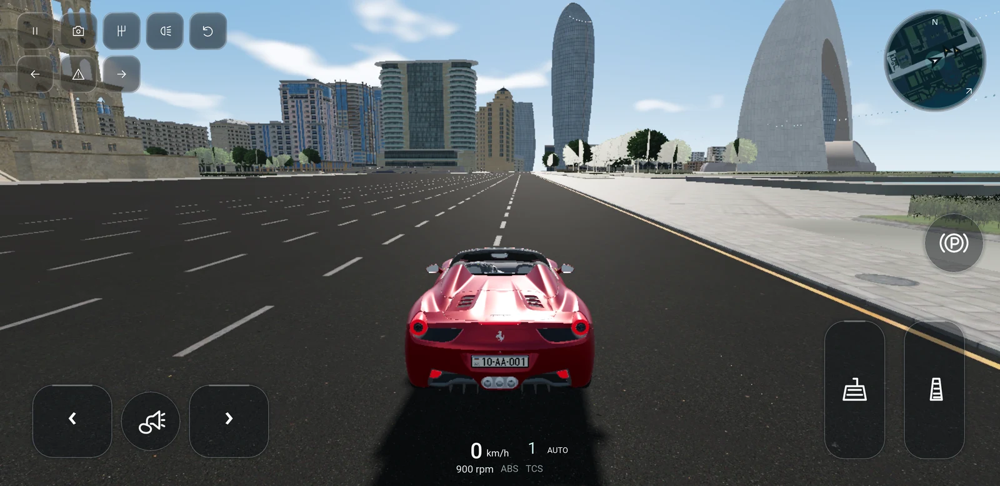
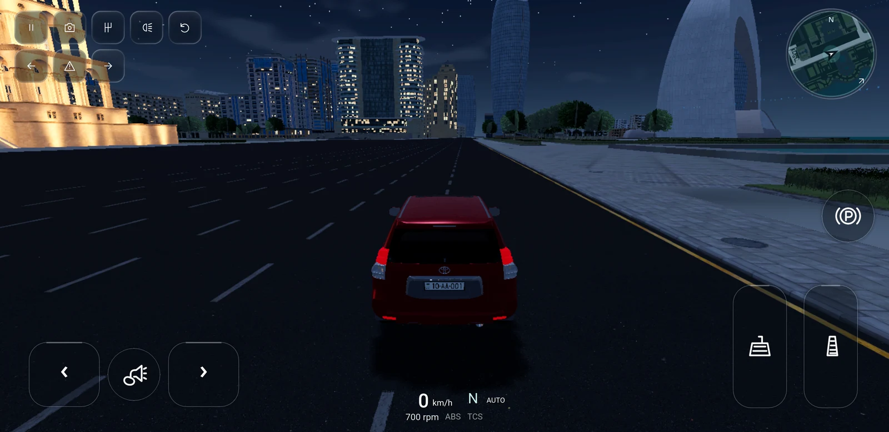
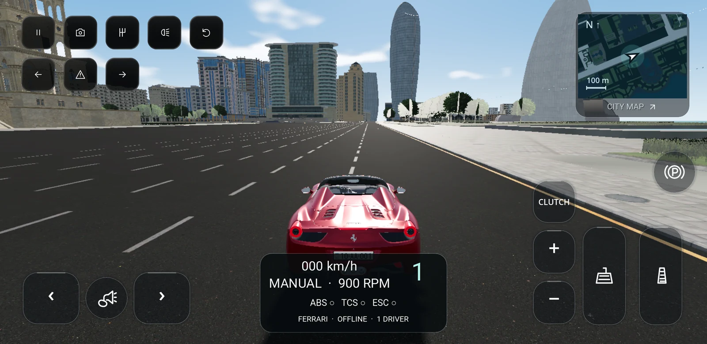
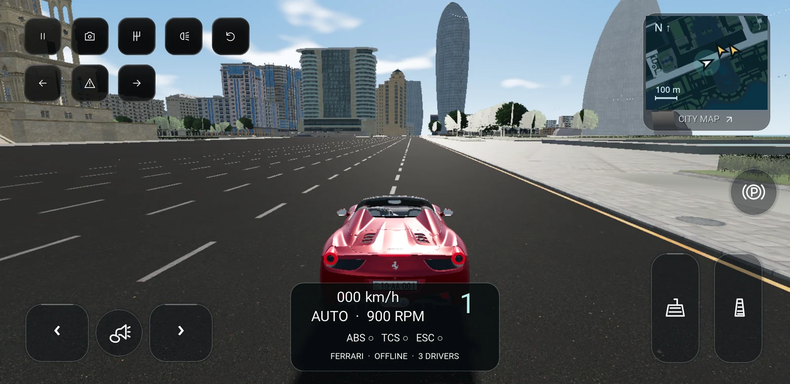
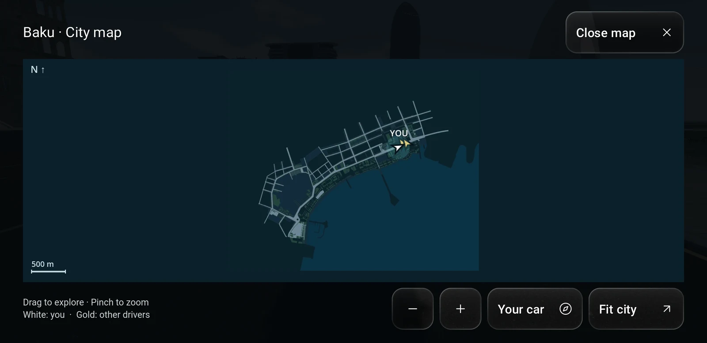
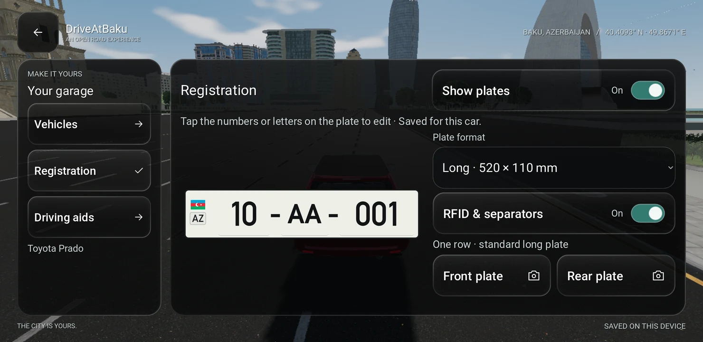
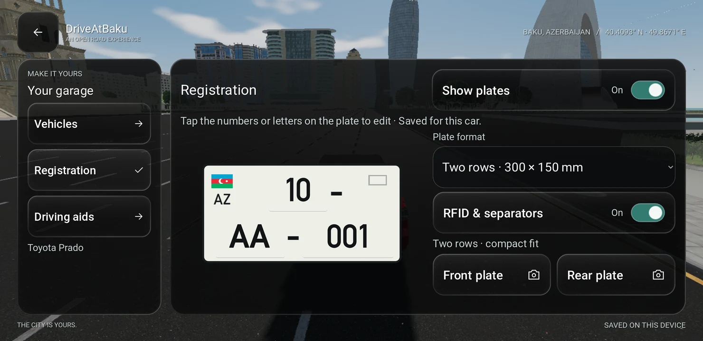
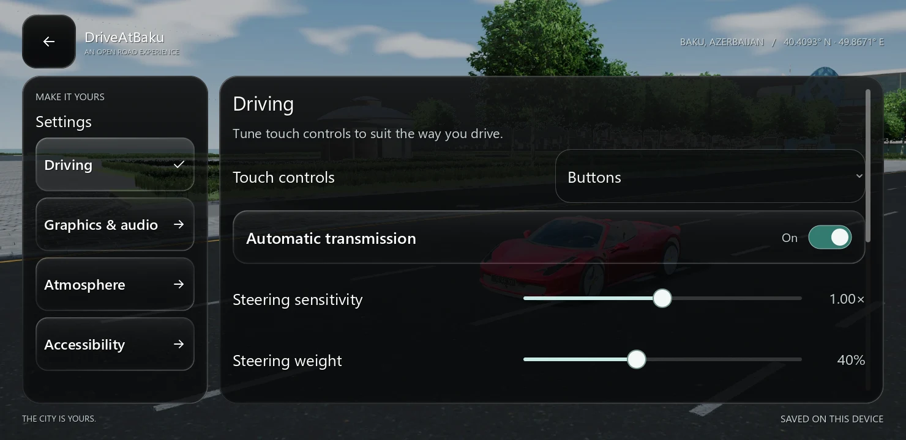
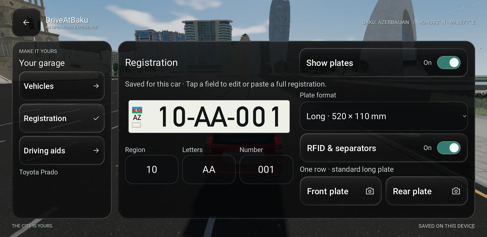
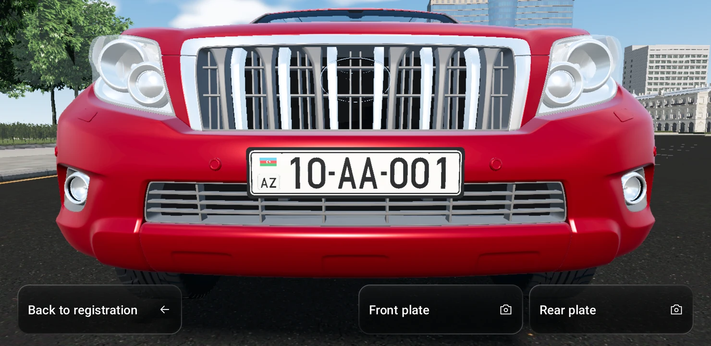

# Android UI, maps and vehicle switching · 0.7

The native client now uses denser settings, clearer control states and a
dedicated registration editor. Vehicle selection updates the existing garage
instead of replacing it with a loading screen or replaying its entrance fade.
The original 0.6 primary Vulkan and OpenGL exports used version code 6.

### 0.7.1 visibility-first HUD

Version 0.7.1 (code 10) removes the bottom instrument card entirely. A
264 × 62 reference-unit text group sits at the bottom edge, replacing the
392 × 166 panel. Speed and gear remain prominent, with smaller units, mode,
RPM and enabled driving aids. Fine text outlines provide contrast with no
background, glass lens or gradient over the car. Aids brighten when active;
normal gameplay no longer repeats the car name, OFFLINE or driver count.
Reconnection warnings still appear when needed.

The top-left controls use 64-unit spacing and 56-unit glass surfaces, closer
to the corner, replacing the previous 88-unit pitch. Menu controls and driving
pedals keep their existing sizes. The minimap is a 144-unit circular view with
a narrow glass rim and subtle expand icon, inside a 152-unit touch target.
There is no large map title/footer or scale legend in the small view. Its
corner footprint is 57% smaller than 0.7.0. Multiplayer markers, heading,
speed-dependent zoom and the expanded map's controls remain available.

The full-game check projects every vehicle mesh's bounds through the driving
camera and checks the readout, toolbar, signals and minimap for overlap. All
four car silhouettes remain clear in the default follow view. The flow also
captures a night-driving HUD, tests manual shifting and map gestures, and
checks periodic multiplayer marker fixtures. Layout checks cover mirrored
controls, both control modes, 75–135% control scale and phone/tablet shapes.

The S9 flow passed 67 checks, including car-body clearance, manual shifts,
map gestures and multiplayer markers. Day/night captures were reviewed, and
the primary game's preferences were preserved. Desktop layout checks passed
with Vulkan and OpenGL. One initial phone run exited during city preparation
without a Godot script/shader diagnostic; a relaunch completed the entire
flow. The cause of that loading interruption remains unconfirmed.






### 0.7.0 driving HUD and interactive maps

Version 0.7.0 (code 9) reduces the top-left glass buttons and artwork by exactly
20%, retaining 88-unit touch areas. Speed, RPM, a prominent current gear,
automatic/manual mode, ABS/TCS/ESC and driver/connection status now sit at the
bottom center. The panel fits between the driving controls in button/slider
and mirrored modes at all supported control scales. Manual controls use the
actual simulation mode, update immediately after the gearbox action, and form
a clutch/shift-up/shift-down column beside the pedals.

The top-right minimap uses a north-up atlas baked from the same 104,049 road
triangles and surface layers used by the web client. The two views share a
2048px GPU-compressed texture with mipmaps. No second city scene or map
geometry is loaded at runtime. Tapping opens the expanded map with drag,
pinch, zoom buttons, Your car and Fit city. Closing or Android Back restores
driving; opening clears held controls and pauses local simulation. Map touches
are excluded from driving-camera gestures.

Both views show white for the local car and gold for other drivers, using
interpolated multiplayer positions and headings. Markers update every 100ms,
disappear on leave/disconnect and expire after three seconds without a new
snapshot. Nearby drivers appear on the minimap; the expanded map covers the
whole city. Peers keep updating while the expanded map is open.

The full-game interface flow exercises actual transmission/shift input,
touch-to-expand/Android Back, map gestures, locate/reset and two deterministic
peers entering through the normal snapshot/interpolation path. It verifies
their position, heading, movement, departure and timeout. These multiplayer
fixtures do not contact the public relay. The separate web map verification
checks all 14 street samples and avoids seven false checkpoint shortcuts.

The Galaxy S9 full-game flow passed all 55 checks. The isolated QA package
preserved the installed primary game's preferences. Desktop interface checks
passed in Vulkan and OpenGL at phone/wide/tablet window shapes (1280 × 720,
1600 × 720 and 1024 × 768), both control modes, mirrored controls and 75–135%
control sizes. The final APK signature is verified; detailed reports and hashes
are retained in `ui-polish-verification.json`. These checks cover UI and peer
fixtures, not sustained multiplayer performance or thermal behavior.







### 0.6.2 inline registration editing

Version 0.6.2 (code 8) replaces the separate Region/Letters/Number form with
three native inputs embedded directly in the white plate, following the web
editor. Regular and pressed DIN faces, subtle field underlines, a visible focus
ring and text selection keep the preview editable without a second set of
controls. Both formats retain at least 88 × 88 reference-unit input targets.
The older long plate now draws its identity frame around AZ, rather than below
it. The compact layout retains the web's separate upper-right RFID detail.

Tests check that exactly three inputs exist, all are children of the preview,
their bounds remain inside the plate, and AZ fits inside its identity frame.
The full-game flow also focuses an inline field, edits the saved and mounted
registration, switches format and returns to front/rear inspection.

The full-game S9 flow passed 32 checks and preserved the primary app's saved
preferences. Desktop interface checks passed with Vulkan and OpenGL, including
both formats and focus/selection styling. The APK signature was verified.





### 0.6.1 badge correction

Version 0.6.1 (code 7) restores the Prado's front Toyota emblem. The mesh was
present, but the native wet-surface shader forced back-face culling instead of
preserving the source chrome material's two-sided setting. Most badge faces
therefore disappeared, leaving a thin outline. Shader variants now include
authored culling as well as transparency. The original badge geometry is used.
The badge regression checks all three culling modes for opaque/transparent
materials and renders the actual Prado front in Vulkan and OpenGL:

```powershell
& $env:GODOT_BIN --path android/game res://tests/badge.tscn
& $env:GODOT_BIN --path android/game --rendering-method gl_compatibility res://tests/badge.tscn
```

The saved verification JSON includes the 0.6.1 device follow-up and APK hash.
The S9 flow passed 24 checks, including the badge material regression, and
preserved the installed game's preferences. Cached switches reached their
first frame in 20–24 ms in that follow-up; first-use shader/resource work was
still variable (about 1.7–3.8 seconds for AMG/Prado in this run).


## Layout and accessibility

- Settings use aligned 88-unit rows, with slider labels, readable values and
  controls on one line. Percentage, sensitivity and distance values show their
  units. Disabled self-centering also disables its dependent speed slider.
- Navigation has a clear selected state and remembers each section's scroll
  position. Garage sections separate Vehicles, Registration and Driving aids.
- Larger type, 36-unit slider thumbs, 72 × 40 switch graphics and explicit
  On/Off text replace small default indicators. The whole switch row responds
  to touch. Wheel scrolling no longer accidentally adjusts sliders.
- Secondary buttons have restrained corners, with darker backing for text.
  Primary actions retain the existing glass identity. Reduced motion stops
  active press/entrance animations immediately; increased contrast is retained.
- The edge toolbar introduced in 0.7.1 uses 64-unit targets and 56-unit glass surfaces;
  this intentionally supersedes the earlier 88-unit toolbar footprint. Menu
  actions retain 88-unit targets. At the smallest driving-control setting,
  pedals, horn, steering,
  clutch, handbrake and shift controls retain at least 88 × 88 reference units.
  Their positions account for physical safe-area insets and avoid overlaps.
- Menus follow focused fields, account for Android keyboard height, use numeric
  keyboards for plate digits, and dismiss editing before Back navigation.
  Native controls provide accessibility names; toggle state also uses text.

The 1480 × 720 reference canvas retains the previous 88-unit menu/driving target
(44 dp at a 740 × 360 dp viewport). Screen density and user overrides differ;
these sizes are not a universal physical measurement. Tests cover landscape
layouts at 1280 × 720, 1600 × 720 and 1024 × 768. TalkBack traversal, large system
font settings and keyboards/cutouts on other devices still need physical QA.

## Registration editor

The editor uses the web's DIN font, Azerbaijani flag, region/letters/number
grouping, long and two-row proportions, and RFID/separator style. As of 0.6.2,
the registration fields are embedded in the plate and retain generous touch
areas. The preview and customization controls share the available landscape width;
narrow layouts stack them and long content remains scrollable.

Like the web editor, it accepts a complete registration pasted into any field,
filters the same allowed alphabet, pads partial positive numbers, keeps
unfinished edits visible, and retains the last valid registration for empty
or zero-only edits. A short debounce updates the mounted geometry after a burst
of typing; leaving the editor commits pending valid changes. A complete pasted
registration saves all three fields together.

Show plates preserves the design while hiding customization. RFID & separators
changes the identity details and dashes together. Preferences and multiplayer
continue to use the existing per-vehicle plate schema. Front/rear inspection
frames the actual mounted plates with the menu out of the way; Back returns to
the same editor without resuming the simulation.

## What delayed vehicle selection

The original loader used threaded resource reads, but then rebuilt everything
on the main thread for each selection. Profiling separates resource acquisition,
scene/material assembly, preference saving, paint, plate geometry, audio and
the initial feedback frame. Full-game QA also measures selection through the
first `RenderingServer.frame_post_draw` after the change.

The main avoidable costs were:

1. Recreating identical water/lamp Shader resources and temporary duplicate
   standard materials for surfaces that immediately received shader overrides.
2. Reconstructing a previously selected model and all of its mutable materials,
   wheel references and lights, even when switching straight back to it.
3. Rebatching identical embossed registration geometry separately for front
   and rear plates, and again for subsequent cars using the same registration.
4. Copying and guarding identical PCM loops for each audio layer and selection.
5. Rebuilding the whole garage and replaying its transition after every change.

The original desktop Vulkan resource/geometry/audio benchmark recorded about
359 ms for a repeated AMG selection and 547 ms for a repeated Prado selection.
It also recorded 1,032 ms of assembly for the first Elantra selection. These
are individual local observations, not averages or device-wide guarantees.
Before/after JSON files are retained under ignored `artifacts/android/`.

The original **0.6** S9 Vulkan run (SM-G960F, Android 10) measured:

| Selection | CPU completion | First frame after selection |
| --- | ---: | ---: |
| First AMG in this process | 257 ms | 372 ms |
| First Prado in this process | 686 ms | 807 ms |
| Cached AMG | 4.5 ms | 19 ms |
| Cached Prado | 4.7 ms | 37 ms |

The 0.6 isolated desktop benchmark measured about 0.5 ms for each cached
selection, compared with 359/547 ms before the changes. The full desktop game
measured about 1.5 ms CPU / 5 ms to first frame for cached selections. Audio
setup after initial preparation dropped from roughly 5–7 ms to 0.2 ms on
desktop, and to about 1.2 ms on the S9. These are observations from the saved
runs; they exclude physical display scanout and are not percentile statistics.
Warm texture/buffer counters stayed unchanged across the two cached S9
selections; peak process memory and sustained multiplayer use were not measured.

The later **0.7.1** S9 functional run recorded the following individual samples.
These are not controlled cold-cache comparisons with the 0.6 measurements:

| Selection | CPU completion | First frame after selection |
| --- | ---: | ---: |
| First AMG in this process | 287.7 ms | 429.1 ms |
| First Prado in this process | 506.9 ms | 652.4 ms |
| Cached AMG | 4.6 ms | 44.4 ms |
| Cached Prado | 5.2 ms | 33.5 ms |

## Changes and memory bounds

- Water shaders share immutable transparency/culling variants; lamp shaders share identical
  source variants. Per-car materials and uniforms remain independent, so paint,
  water, lamps and indicators do not leak between vehicles or peers.
- The local player retains at most one previous prepared model. It is detached
  from the scene tree, so it does not draw, light the city or process. Selecting
  a third car evicts the oldest inactive model. Peers retain no inactive cars.
  Android memory-pressure notifications release the inactive local model.
- Each plate builder retains at most eight recent immutable plate templates.
  Front/rear lettering shares its existing batched geometry. The embossed
  meshes, plate lighting and visual quality are unchanged.
- A shared cache retains at most twelve guarded PCM streams (the current stock
  banks use ten unique loops). Playback offsets, pitch, gain, filters and buses
  remain independent. PCM quality, overlap conditioning and the loop boundary
  guard are retained. Memory pressure drops cache references without stopping
  active playback.
- Metadata is parsed once. New models stay hidden during material setup.
  A prepared selection needs no loading frame. Selecting the current vehicle
  is a no-op. The garage stays visible, blocks duplicate changes while busy,
  and updates its cards in place on completion. Failed reads preserve the
  existing car and offer another selection attempt.

First-use resource loading, renderer uploads and first-draw pipeline work
remain slower than cached selection. Repeated tests benefit from OS and driver
caches. The measurements do not isolate GPU compilation from every renderer
stall, establish a sustained frame-rate improvement, or promise instant cold
spawning. No geometry, textures, rendering-quality settings or simulation
equations were reduced for these optimizations.

## Verification

The saved [verification report](ui-polish-verification.json) records the latest
S9 functional result and CPU/first-frame timings. The original 0.5 screenshot
guide remains in [MOBILE_INTERFACE.md](MOBILE_INTERFACE.md).

The latest 0.7.1 S9 full-game flow passed **67 checks** and preserved the primary
app's preference hash. The original 0.6 flow passed 23; 0.6.1/0.6.2/0.7.0 passed
24/32/55 respectively. The separate cache/switch regression recorded **64
checks**. Native interface layout/rendering checks passed with desktop Vulkan
and OpenGL. The saved report keeps those versions separate.

Desktop-rendered Driving settings:



Registration and mounted-plate inspection, captured on the Galaxy S9:





```powershell
node android/tools/prepare_interface.mjs
& $env:GODOT_BIN --headless --path android/game --editor --import --quit
node android/tools/configure_imports.mjs
& $env:GODOT_BIN --headless --path android/game --editor --import --quit
& $env:GODOT_BIN --path android/game res://tests/interface.tscn
& $env:GODOT_BIN --path android/game res://tests/vehicle_switch.tscn
& $env:GODOT_BIN --path android/game res://tests/interface_flow.tscn
& $env:GODOT_BIN --headless --path android/game --export-debug 'Android Interface QA' ../build/DriveAtBaku-interface-qa.apk
node android/tools/verify_interface_device.mjs
# Rerun the same installed QA build without reinstalling:
node android/tools/verify_interface_device.mjs --reuse-install
```

The standalone interface check covers navigation, layout bounds, target sizes,
registration sanitization/paste/invalid edits, style and disabled states, and
inspection Back behavior. The switch check covers cache eviction, model
identity, shared plate meshes, independent peer materials/paint, PCM reuse and
memory-pressure cleanup. The full-game flow covers real city/vehicle loading,
pause/resume, garage retention, front/rear cameras and reconnect feedback.

Additional passing regressions: native touch controls, 266 vehicle feature
checks, 584 audio/plate checks, 144 presentation/audio targets, the 32 Windows
simulation reference runs (57,600 scalar samples, zero difference), world
collision fixtures and the web production build. These fixture runs do not
replace a sustained driving or thermal test. Godot still reports the previously
recorded seven texture RIDs at full-game renderer shutdown; sustained allocation
behavior needs separate investigation.

## Approved branding follow-up — 0.7.2

A1 Old City Drive is applied across web and native branding in 0.7.2/code 11.
The interface and 67-check full-game flow were rerun on desktop after those
changes. The newly built isolated QA APK also passed all 67 checks on the S9
when it reconnected, preserving primary-game preferences. Existing captures
above remain 0.7.1 or their explicitly labeled earlier versions. See
[branding validation](../branding/VERIFICATION.md) for packaged-icon checks,
current APK hashes and the final menu previews.
