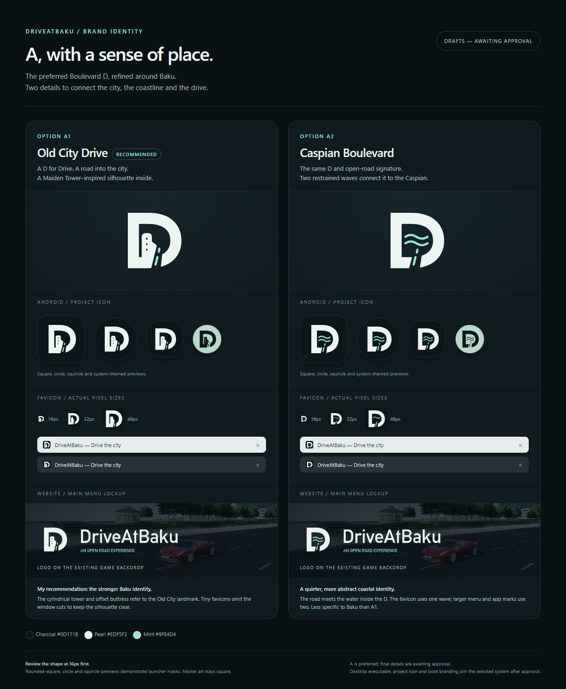
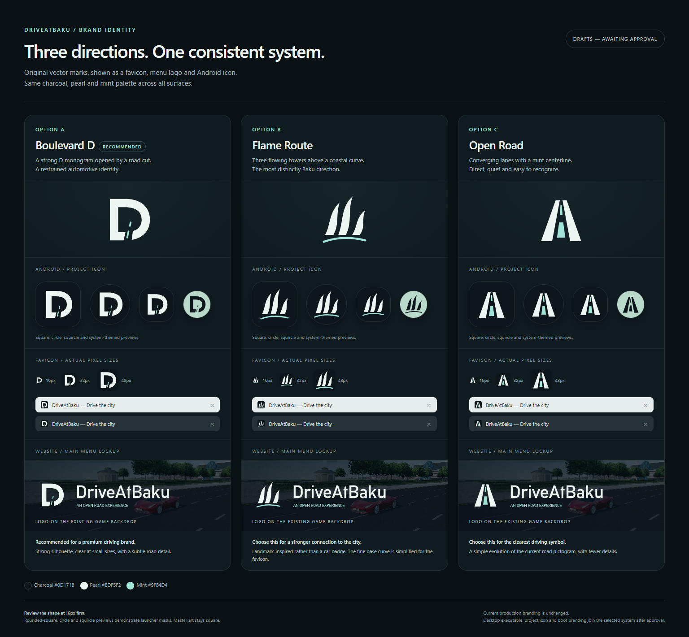

# DriveAtBaku brand identity

**Approved: A1 — Old City Drive.** The user selected A1 after reviewing the
original directions and the two A refinements. The D stands for Drive, the
opening is a road into the city, and the cylindrical silhouette with an offset
buttress refers to Baku's Maiden Tower. Pearl, charcoal and mint remain the
shared palette. Small favicons omit the tower windows for clarity.

## Production identity

- Vector masters: `public/branding/mark.svg`, `wordmark.svg`, `app.svg` and
  `favicon.svg`. These are finalized copies of the approved A1 paths.
- Website: outlined menu/loading wordmark, SVG/PNG/ICO favicons, Apple touch
  icon and matching browser theme color. Images retain accessible names.
- Native: `android/game/icon.png`, matching menu/loading mark and a custom
  transparent boot mark on charcoal; no default Godot boot image.
- Android: all 11 presets explicitly configure legacy, adaptive foreground,
  background and monochrome resources under `android/game/branding/`.
  Foreground art fits the central 66/108 safe circle; themed icons use white
  RGB with alpha and no painted background. Launcher masks belong to Android.
- Windows: a six-size ICO (16, 32, 48, 64, 128, 256), explicit taskbar/native
  icon and enabled executable resource replacement. Small ICO frames use the
  simplified favicon artwork.

Regenerate the raster and ICO outputs with `npm run build-branding`; validate
browser declarations, all presets, adaptive safe bounds, monochrome alpha and
ICO sizes with `npm run verify-branding`. The Node scripts use the pinned
project dependency `sharp`. The final production assets do not depend on Python
or the review generators. PNG native assets preserve the approved SVG masks
consistently across importers. All generated assets are committed.

The new branded exports are **0.7.2, version code 11** (main, fallback and
interface QA). The new 0.7.2 QA APK passes 67 checks on the Galaxy S9 with primary-game
preferences unchanged. Earlier 0.7.1 evidence retains its original version.

## Review history

The remaining proposals are preserved as design history, not production assets.
A was preferred, B and C were rejected, and A1 was subsequently approved.

[Open the A refinements](proposals/a-refinements.html) · [A refinement contact sheet](proposals/a-refinements.png)



| Refinement | Meaning | Review recommendation |
| --- | --- | --- |
| **A1 — Old City Drive** | D for Drive, an open road and a Maiden Tower–inspired cylindrical silhouette with an offset buttress | Recommended for the clearer connection to Baku |
| **A2 — Caspian Boulevard** | The same D and road with two waves referring to the Caspian coast | A quieter, less geographically specific alternative |

A1 omits its small window cuts in favicons. A2 reduces two waves to one in
favicons. The larger menu and app marks retain the details. Both use the same
palette and typography as A. The refinement board was rendered and visually
inspected; all 22 images loaded at 1200, 768, 390 and 360px widths without
horizontal overflow. Generate the refinement SVGs with
`python docs/branding/proposals/build_a_refinements.py`.

## Original proposal round

The following proposals are preserved as review history. B and C are no longer
under consideration.

[Open the comparison](proposals/review.html) · [Full-size contact sheet](proposals/branding-options.png)



| Option | Direction | Best fit |
| --- | --- | --- |
| **A — Boulevard D** | A geometric D opened by a road cut and a mint lane divider | Recommended: compact, recognizable automotive monogram |
| **B — Flame Route** | Three flowing towers and a coastal road curve | Strongest connection to Baku |
| **C — Open Road** | Two converging lanes with a mint centerline | Most direct, minimal driving symbol |

Each system includes a transparent mark, menu wordmark, optically adjusted
favicon, full-bleed app icon and a themed-icon preview. The comparison shows
16/32/48px favicons, light/dark browser tabs, launcher masks and the menu logo
against an existing in-game capture. Select a system as a whole so the favicon,
main menu and native icons share one identity.

Palette: charcoal `#0D171B`, pearl `#EDF5F2`, mint `#9FE4D4`. Shape and contrast
carry recognition; small marks do not depend on glossy rendering. Liquid-glass
surfaces remain in the UI rather than being baked into every icon.

The marks are original code-authored SVG paths. The wordmark is outlined from
the existing Alte DIN 1451 regular font; it has no external font dependency.
Font attribution and the bundled OFL notice are recorded in
[asset credits](../ASSET_CREDITS.md). Menu backdrops are existing game captures.
Themed previews demonstrate a system-colored result, not final Android
foreground/mask exports. Production adaptive layers and platform-safe insets
will be finalized for the selected option.

## Audit before A1 implementation

| Surface | Current state | Selected-system work after approval |
| --- | --- | --- |
| Website favicon | No explicit favicon links in `index.html` | SVG plus PNG/ICO fallbacks and appropriate declarations |
| Website menu/loading | Generic inline `icon-road` plus text | Matching mark/wordmark, preserving accessible text and mobile spacing |
| Godot project/native menu | Custom car project SVG; generic road menu/header | Matching project icon and compact menu/header logo |
| Android launcher | Regular/adaptive foreground are the old car | Correctly sized legacy/adaptive layers, consistent across main and QA presets |
| Android themed icon | **Godot mark remains in the packaged monochrome resource** | Explicit one-color selected mark; inspect the rebuilt APK rather than only the source SVG |
| Windows executable | Resource modification disabled; no custom executable icon | Multi-resolution ICO and enabled resource replacement, with exported-file verification |
| Game boot/window surfaces | Not finalized in this review | Audit and replace game-facing default branding where present |

The pre-implementation Android finding was checked in the existing 0.7.1 APK. Extracted inspection
images remain local under ignored `artifacts/branding-current/`. This task does
not change the installed Godot editor's own branding.

## Approval and handoff

A1 approval completed the requested branding selection gate. The selected
system is applied to production sources; verification and export evidence are
recorded in [verification](VERIFICATION.md). Rejected drafts remain in the
proposal directory and are not referenced by the game.

Draft regeneration from the repository root:

```sh
python docs/branding/proposals/build_previews.py
```

This requires `fontTools` and the existing local font files. Serve or open
`proposals/review.html` to inspect the source SVGs without screenshot scaling.
`branding-options.png` is a rendered copy of that review page. Draft files are
not referenced from `index.html`, `public/`, `project.godot` or export presets.

The review page was checked at 1536, 768, 390 and 360px widths: all 33 images
loaded, with no horizontal overflow. The generated SVG wordmarks contain paths,
so the preview does not require a system font to reproduce the logo lettering.
