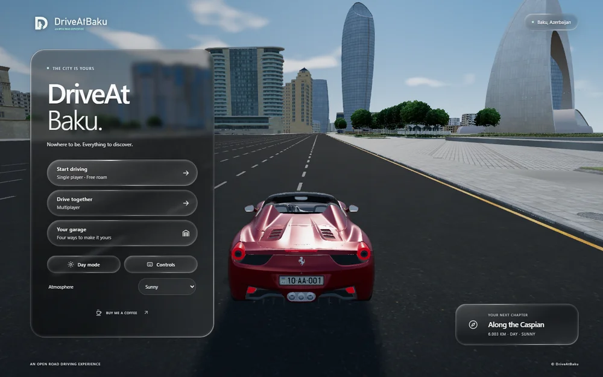
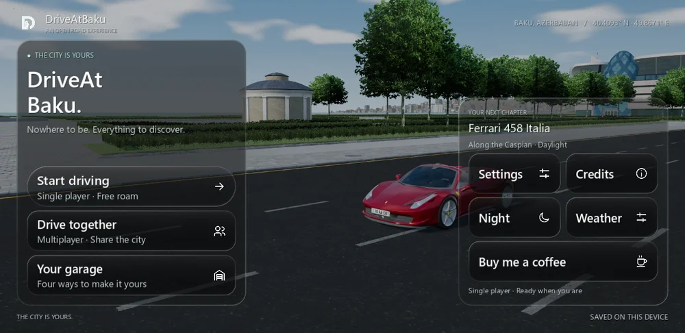
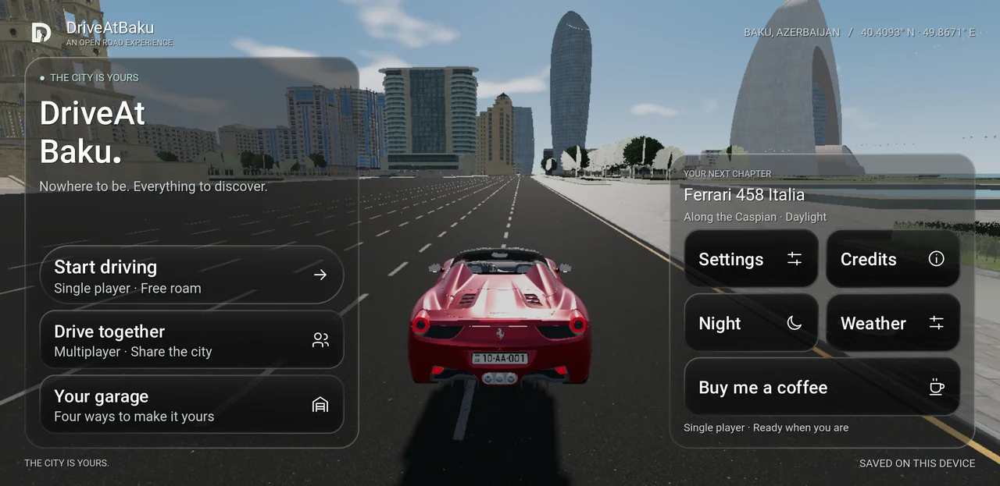

# Approved A1 branding verification

The user selected **A1 — Old City Drive** after comparing the proposals.
The finalized D/road/Maiden Tower-inspired identity is applied to website,
native menus/loading, Android launcher/themed icons, Godot project/boot and
Windows executable/taskbar. Main, OpenGL and interface-QA exports are
**0.7.2, version code 11**. The [machine-readable record](verification.json)
contains hashes, packaged-icon results and both desktop and S9 full-game flows.

## Final checks

| Check | Result |
| --- | --- |
| Web production build | Pass; existing large-chunk advisory remains |
| Existing non-browser web regression | All 26 suites pass |
| New branding verification | Pass; included as the 27th non-browser suite |
| Chrome interface suite | Pass; loading, navigation, garage, multiplayer form, driving and settings; no page errors |
| Logo layout | Visible and contained at 1440×900, 390×844, 844×390 and 320×568; accessible names and favicon URLs checked |
| Complete native Verify target | Pass: 57,600 simulation samples with zero difference; collision fixtures, controls, 144 presentation targets, 266 vehicle features, 584 audio/plate checks, interface, 64 cache checks, badge, smoke and browser/native relay |
| Desktop rendered interface | Pass on Vulkan and OpenGL, including menu layouts at 1024×768, 1280×720 and 1600×720 |
| Desktop full-game flow | 67 checks pass on Vulkan; all four cars clear the HUD in the default follow view |
| Galaxy S9 / Android 10, Vulkan | New 0.7.2 interface-QA APK passes all 67 full-game checks; primary app preferences remain unchanged |
| Exported Windows game | Headless driving smoke passes for all four cars |
| APKs | Main, OpenGL fallback and interface QA export successfully; v2/v3 signatures verify |
| Packaged Android artwork | 24 icon resources checked in each APK; highest-density legacy/foreground/background/monochrome images match approved sources within one RGB-level rounding |
| Windows PE resources | All 16/32/48/64/128/256 icon frames match the custom ICO; no stock-size fallback |

Adaptive source pixels are verified inside Android's central 66/108 safe
circle. The monochrome source contains white RGB plus alpha. Godot resampling
can slightly darken antialiased RGB at smaller densities; packaged masks remain
achromatic and transparent. Every Android export preset supplies all four icon
resources explicitly. The legacy car icon, stock monochrome silhouette and
default engine boot image are replaced.

The web uses outlined vector lettering with accessible alternative text.
Native headers preserve readable text beside the matching transparent mark.
Native PNGs are derived from the approved SVGs so browser/Godot SVG mask
differences cannot fill in the road opening or tower windows.

The S9 reconnected during final validation. The newly exported, isolated
interface-QA package was installed and completed the full flow. Its report
confirms the primary game's preference hash was unchanged. This validates the
new branded gameplay build on that phone; it does not install the new main
package over the user's existing game.

## Final menu previews

These captures preserve the 0.7.2 branding validation. For current v1.0.0
Web and Windows previews, see the [screenshot gallery](../SCREENSHOTS.md).

Website, actual Chrome capture:



Native desktop Vulkan, actual game capture:



Galaxy S9, new 0.7.2 interface-QA build:



## Reproduce

```sh
npm run build-branding
npm run verify-branding
npm run build
npm run verify
# Start the local dev server, then:
npm run verify-interface-browser
python android/tools/verify_branding_exports.py
```

The export checker requires Pillow and the three APKs plus Windows executable
under `android/build/`. It reads APK images and the actual PE icon resources,
rather than trusting export settings alone. Standard native build and device
commands are in the [Android guide](../../android/README.md) and
[UI verification guide](../android/UI_POLISH_AND_SWITCHING.md).

Raw logs, full-resolution screenshots and extracted resources remain local
under `artifacts/android/branding-*` and `artifacts/branding-final/`. Build
binaries, SDK paths, signing files and raw test output are not committed.

## Known limits

The previously recorded seven texture RID warnings remain at full-game Vulkan
shutdown. A headless audio/plate fixture also reports an ObjectDB exit warning;
the assertions pass. These warnings are preserved, not presented as resolved.
The build wrapper now handles native stderr warnings without losing its
exit-code and script/parse/shader-error checks.

This pass does not establish sustained memory/FPS/thermal behavior or certify
every Android device, launcher, TalkBack path or system text scale. Earlier
0.7.1 S9 timing samples remain versioned in the
[UI/switching report](../android/UI_POLISH_AND_SWITCHING.md); they are not
relabelled as fresh branding performance measurements.
